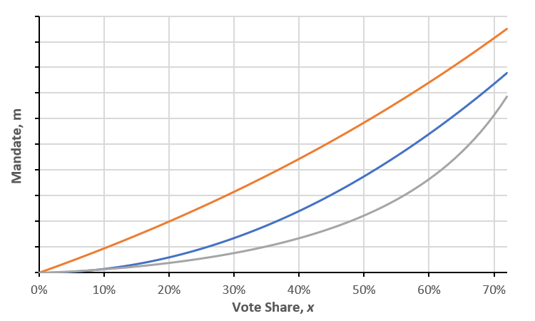
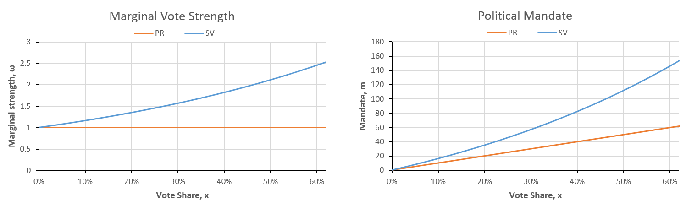
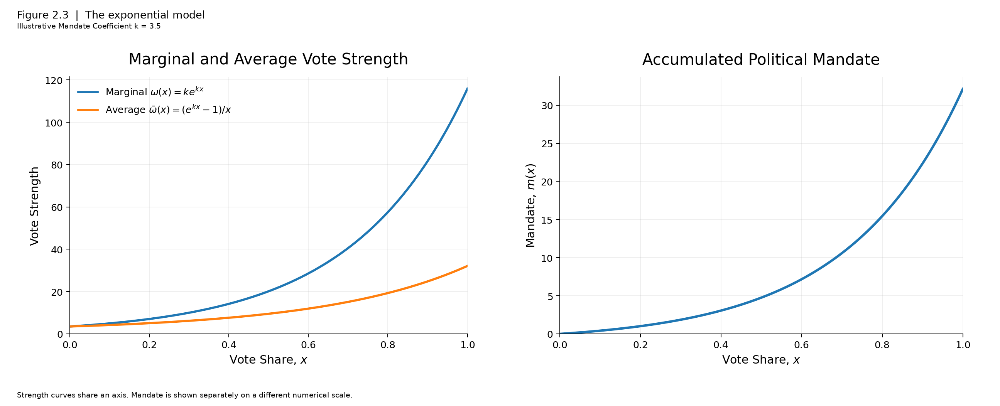

# The Mandate Equation

The previous section introduced **Political Mandate** as the distinguishing feature of Strengthened Voting. To establish its mathematical form, we first need to examine what that measure is intended to recognise.

## Political Agreement

A political party brings people with different beliefs, priorities and interests into support for a common programme. Its supporters need not agree about everything; rather, they have reconciled enough of their differences to advance a shared political position.

SV proposes that **broadening an existing political agreement is an achievement worthy of electoral recognition**. Attracting additional voters to an established agreement is not treated as equivalent to attracting the same number of voters to a smaller one: a broader agreement accommodates a larger collection of competing preferences and priorities.

This does not guarantee that the larger party has better policies or is more likely to govern well. The achievement SV seeks to recognise is the breadth of support brought together behind a common, actionable programme. We must now find a mathematical expression for that principle.

## Convexity and Marginal Strength

Let $m(x)$ denote a party's **Political Mandate** as a function of its Vote Share, $x$. A party with no votes has no Mandate, so $m(0)=0$.

The principle of strengthening requires Mandate to increase as Vote Share increases, but also to increase at an **increasing marginal rate**: the same increase in Vote Share should produce a greater addition to Mandate for a larger party than for a smaller one.

Mathematically, this calls for a strictly increasing, **convex** function. The graph below provides examples of several such possible convex functions. Convexity is a criterion for the Mandate Equation, but it does not yet determine a specific function.

<!-- figure-id: mandate-convexity -->

*Figure 2.1 — Illustrative convex Mandate functions. An increasingly steep slope represents greater strengthening of larger political agreements.*

To examine the slope formally, consider a very small increase in Vote Share, $dx$, and the corresponding increase in Mandate, $dm$. Their ratio is the **Marginal Vote Strength**, denoted by $\omega(x)$:

<!-- equation-id: marginal-vote-strength -->
<!-- equation-name: Marginal Vote Strength -->

**Marginal Vote Strength**

$$
\boxed{\omega(x)=\frac{dm}{dx}}
\tag{2.2}
$$

For comparison, a linear function such as $m(x)=x$ has constant Marginal Vote Strength, $\omega(x)=1$. It counts support without granting additional strength to larger agreements.

The total Mandate accumulated up to Vote Share $x$ is the area under the Marginal Vote Strength curve from zero to $x$:

$$
m(x)=\int_0^x\omega(t)\,dt
$$

Here $t$ is simply the variable of integration, while $x$ marks the Vote Share at which we stop accumulating Mandate.

<!-- figure-id: marginal-strength-intuition -->

*Figure 2.2 — Marginal Vote Strength and accumulated Political Mandate. The area under the Strength curve up to a chosen Vote Share equals the Mandate earned at that Vote Share.*

This establishes how a Marginal Vote Strength curve determines Mandate. It leaves open *which* increasing curve SV should adopt.

## Proportional Strengthening

SV models the additional Mandate earned as Vote Share increases through two components:

**a) Baseline support:** an additional contribution from the inherent value of the electoral support itself.

**b) Strengthening of existing agreement:** a further contribution proportional to the Mandate already accumulated by the party.

This is the **proportional-strengthening assumption**. It reflects the proposition that extending an already broad political agreement involves accommodating an increasingly diverse range of preferences. SV models the additional achievement as proportional to the Mandate already accumulated.

We express the two components of Marginal Vote Strength as:

<!-- equation-id: proportional-strengthening -->
<!-- equation-name: Proportional Strengthening -->

**Proportional Strengthening**

$$
\boxed{\omega(x)=\underbrace{a}_{\text{Baseline}}+\underbrace{b\,m(x)}_{\text{Strengthening}}}
\tag{2.3}
$$

Here $a>0$ is the baseline vote strength, and $b>0$ determines the additional strengthening associated with existing Mandate. Because $m(0)=0$, the initial Marginal Vote Strength is $\omega(0)=a$.

Substituting the definition of $\omega(x)$ gives the differential equation:

$$
\frac{dm}{dx}=a+bm
$$

Solving this equation subject to $m(0)=0$ yields:

Show the differential-equation solution

Separating the variables:

$$
\frac{dm}{a+bm}=dx
$$

Integrating both sides:

$$
\frac{1}{b}\ln(a+bm)=x+C_1
$$

Since $a>0$ and the Mandate remains non-negative, $a+bm>0$. Exponentiating and absorbing the integration constant into a new constant $C$:

$$
a+bm=Ce^{bx}
$$

Rearranging:

$$
m(x)=\frac{Ce^{bx}-a}{b}
$$

Applying the initial condition $m(0)=0$ gives $C=a$. Therefore:

$$
m(x)=\frac{a}{b}(e^{bx}-1)
$$

The factor $a/b$ scales all parties' Mandates by the same amount. Since legislative representation will depend on each party's *proportion* of Total Mandate, this common factor will cancel. We are therefore free to choose units in which $a/b=1$, and rename $b$ as the **Mandate Coefficient**, $k$.

We obtain the unscaled Mandate function:

$$
m(x)=e^{kx}-1,\qquad k>0
$$

Its Marginal Vote Strength is the derivative:

$$
\omega(x)=ke^{kx}
$$

Differentiating again confirms an important property:

$$
\frac{d\omega}{dx}=k^2e^{kx}=k\omega(x)
$$

In other words, **Marginal Vote Strength grows in proportion to its existing value**, at a rate determined by $k$. This compounding relationship explains the exponential form of the **Mandate Equation**.

The **Average Vote Strength** is the Mandate accumulated per unit of Vote Share. For $x>0$, this is $\overline{\omega}(x)=m(x)/x$. Under the exponential model:

$$
\overline{\omega}(x)=\frac{e^{kx}-1}{x}
$$

Average Vote Strength differs from Marginal Vote Strength: the latter measures the contribution of the *next* increment of support, while the former averages the contributions of *all* support accumulated so far. For example, where Marginal Vote Strength has reached five times its initial value, Average Vote Strength is approximately 2.49 times its initial value.

<!-- figure-id: mandate-equation-linked-graphs -->

*Figure 2.3 — Marginal Vote Strength, Average Vote Strength and Political Mandate under the exponential model (illustrative $k=3.5$). Average Strength lies below Marginal Strength as Vote Share increases. Increasing $k$ concentrates Mandate more strongly among larger parties.*

The exponential form follows from our proposed **proportional-strengthening assumption**. We can now use it to calculate Mandate; the appropriate strength of that strengthening, $k$, remains to be established.

## Choosing a Mandate Scale

The unscaled equation quantifies Mandate, but its numerical values are not especially intuitive. We can multiply all parties' Mandates by a common **Scaling Coefficient**, $A$, without affecting their eventual Mandate Shares.

Writing the scaled function as $M(x)$ gives the principal equation of SV:

<!-- equation-id: mandate-equation -->
<!-- equation-name: Mandate Equation -->

**Mandate Equation**

$$
\boxed{M(x)=A(e^{kx}-1)}
\tag{2.4}
$$

SV adopts the convention that a party with exactly **50% Vote Share earns 1,000 Mandate points**. This provides a convenient reference: Mandate exceeds 1,000 precisely when Vote Share exceeds 50%.

The condition $M(0.5)=1000$ fixes the Scaling Coefficient:

<!-- equation-id: scaling-coefficient -->
<!-- equation-name: Scaling Coefficient -->

**Scaling Coefficient**

$$
\boxed{A=\frac{1000}{e^{k/2}-1}}
\tag{2.5}
$$

Show the Mandate Equation with the Scaling Coefficient substituted

Substituting the Scaling Coefficient from equation (2.5) gives the equivalent expression:

$$
M(x)=1000\frac{e^{kx}-1}{e^{k/2}-1}
$$

This normalisation holds for every positive value of $k$. It changes the units of Political Mandate, not the relative Mandates earned by parties.

## Mandate Share

Political Mandate is not itself a number of seats. To determine a party's intended share of the legislature, we compare its Mandate with the **Total Mandate** earned by all qualifying parties.

Let $M_i=M(x_i)$ be the Mandate earned by Party $i$. Since an Electoral Threshold would have already been applied in defining eligible Vote Shares, the Total Mandate is:

$$
\Sigma M=\sum_{j\in\mathcal E}M_j
$$

Party $i$'s **Mandate Share**, $f_i$, is then:

<!-- equation-id: mandate-share -->
<!-- equation-name: Mandate Share -->

**Mandate Share**

$$
\boxed{f_i=\frac{M_i}{\Sigma M}},\qquad i\in\mathcal E
\tag{2.6}
$$

Mandate Share is a continuous proportion between zero and one. It describes SV's intended allocation of legislative representation *before* an apportionment method assigns whole seats. The distinction between Mandate Share and actual Seat Share will become important in Implementation.

It is also worth noting that the Total Mandate, $\Sigma M$, of an election is not a fixed value. Generally speaking, elections that consolidate votes into a small number of parties will have a high $\Sigma M$, whilst elections with votes split across multiple smaller parties will have a low $\Sigma M$.

## A Worked Election

Consider five parties receiving Vote Shares of **40%, 30%, 15%, 10% and 5%**, with no parties excluded by the Electoral Threshold. For now, we choose an *illustrative* Mandate Coefficient $k=3.5$, giving $A\approx210.32$.

<!-- table-id: five-party-worked-election -->

**Table 2.1 — Mandate and Mandate Share in an illustrative five-party election ($k=3.5$).**

| Party | Vote Share $x_i$ | Political Mandate $M_i$ | Mandate Share $f_i$ |
|:---|---:|---:|---:|
| A | 40% | 642.58 | 49.17% |
| B | 30% | 390.71 | 29.90% |
| C | 15% | 145.22 | 11.11% |
| D | 10% | 88.14 | 6.74% |
| E | 5% | 40.22 | 3.08% |
| **Total** | **100%** | **1,306.87** | **100.00%** |

Although Party A receives 40% of Vote Share, it earns approximately **49.17% of Mandate Share**. This reflects both its own support and the division of votes among its opponents. Its final proportion of legislative representation cannot be determined from its own Vote Share alone.

As can be seen from the figure below, selecting a higher value for $k$ further extends Party A's lead over other parties, whilst a low $k$ converges on proportional representation.

<!-- planned-figure-id: worked-election-mandate -->
<!-- PROPOSED FIGURE 2.4 (provisional; not yet published): The effect of the Mandate Coefficient on a five-party election. Display the Mandate curve beside the existing election table. A slider for k updates each Mandate and Mandate Share, preserving M(0.5)=1000. Show continuous shares only; do not introduce whole seats or an apportionment method on this page. Include a numbered caption and static image fallback when the figure is implemented. -->

We now have a rule for calculating Political Mandate and converting it into Mandate Share. What remains to be determined is the value of the **Mandate Coefficient**, $k$, which controls how strongly the model rewards larger political agreements. How should that coefficient be chosen?

---

**Previous:** From Votes to Seats  
**Next:** The Mandate Coefficient
