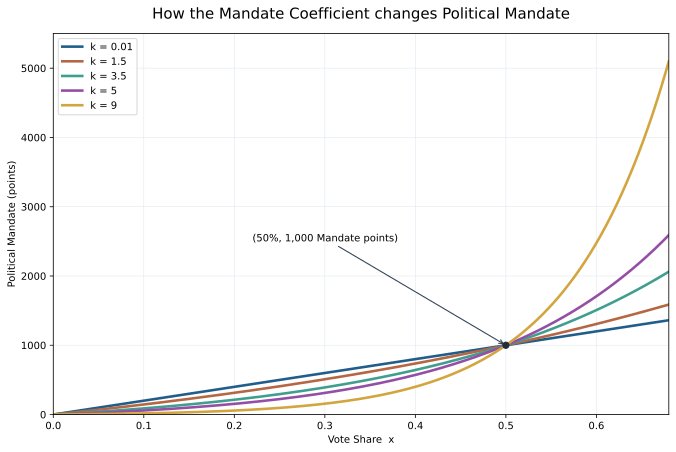
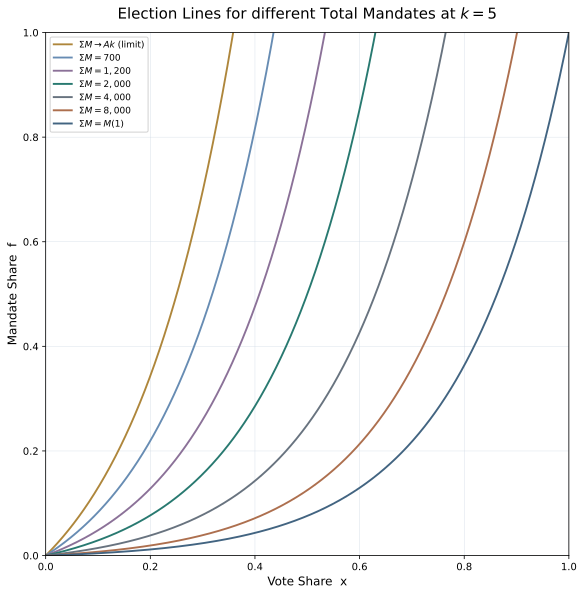
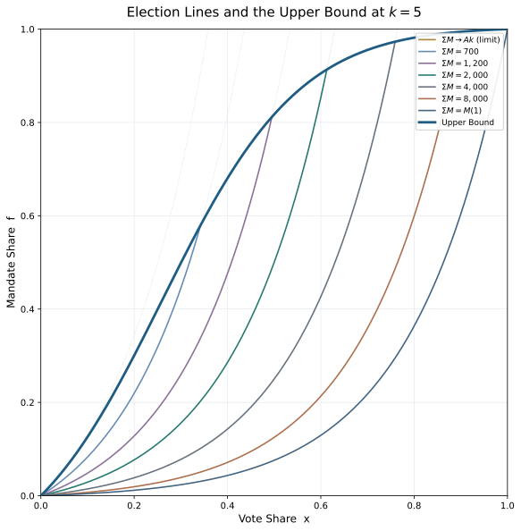
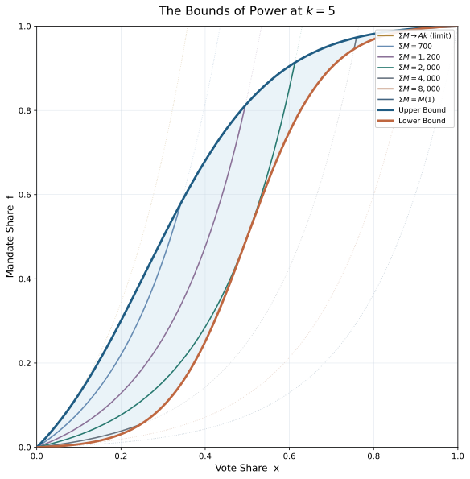
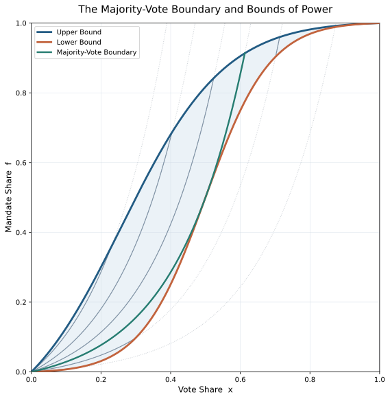
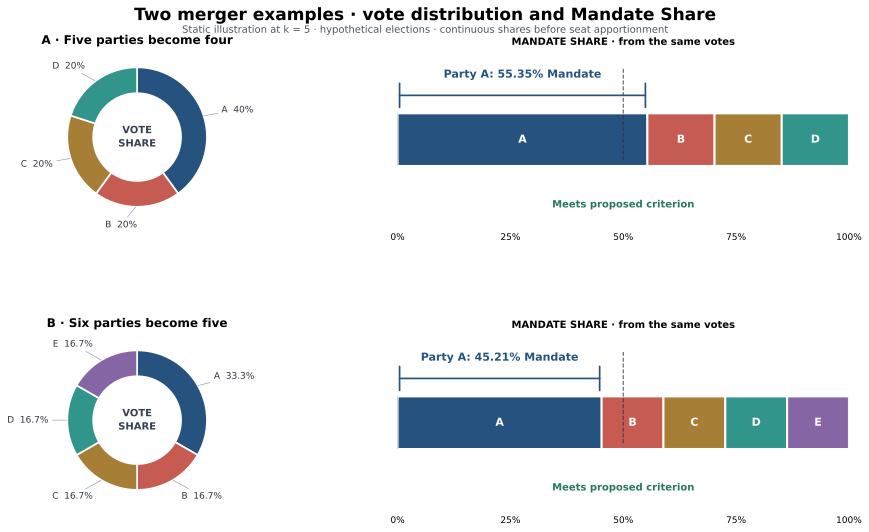
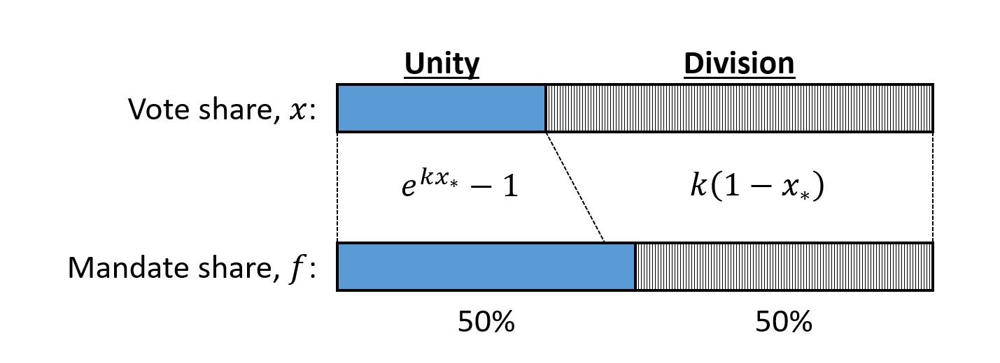
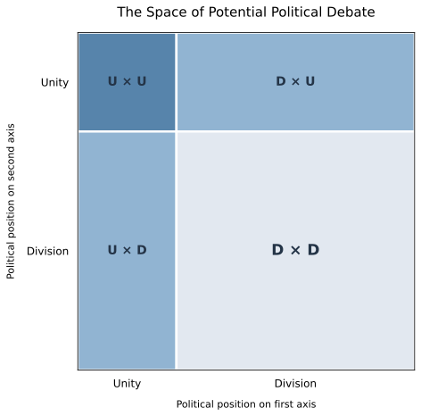
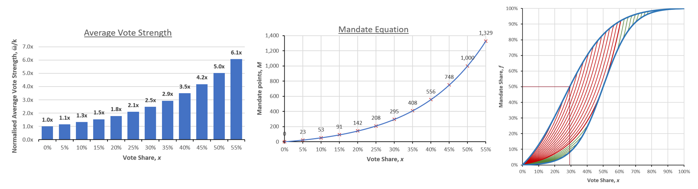

# The Mandate Coefficient

The Mandate Equation establishes *how* Strengthened Voting recognises broader political agreement. What remains is to decide *how strongly* it should do so. That choice is governed by the **Mandate Coefficient**, $k$.

We will first examine how $k$ changes the relationship between Vote Share and Mandate Share, then identify the limits of that relationship. Finally, we will propose a political criterion for selecting a particular value of $k$.

## What Do Values of $k$ Mean?

Recall the Mandate Equation, $M(x)=A(e^{kx}-1)$, and Mandate Share, $f_i=M_i/\Sigma M$. Increasing $k$ makes Mandate grow more sharply with Vote Share. The Scaling Coefficient $A$ adjusts alongside $k$ so that $M(0.5)=1000$ remains true.

<!-- figure-id: mandate-coefficient-family -->

*Figure 2.5 — The Mandate Equation for different values of $k$. Every curve passes through (50%, 1,000 points), but larger coefficients produce increasingly strong growth at higher Vote Shares. The $k=0.01$ curve is nearly linear, illustrating the approach to the proportional relationship.*

For a very small positive value such as $k=0.01$, the Mandate curve is almost a straight line. The resulting distribution of Mandate Share is correspondingly close to **direct Proportional Representation**, i.e.

$$
\lim_{k\to0^+}f_i=x_i
$$

The limiting relation is exact, even though $k=0$ itself is not a valid value for $k$.

A very low value of $k$ would therefore make SV recreate the weaknesses of PR, such as **political fragmentation** and unstable coalitions.

At the other extreme, a large $k$ increasingly favours the party with the greatest Vote Share. Consider two parties receiving 41% and 39% respectively. The ratio of their Mandates is:

$$
\frac{M(0.41)}{M(0.39)}
=\frac{e^{0.41k}-1}{e^{0.39k}-1}
\sim e^{0.02k}\qquad(k\to\infty)
$$

For $k\approx35$, the first party earns about twice the Mandate of the second; for $k\approx116$, the ratio is about ten to one. If one party has a *strictly* larger Vote Share than every opponent, its Mandate Share tends towards 100% as $k$ becomes arbitrarily large.

This extreme concentration recalls **Duverger's law**, which describes how First-Past-the-Post tends to favour competition between two viable parties or candidates. Under FPTP, the prospect of wasting votes on an unlikely winner can motivate strategic voting; under SV with a very large $k$, it is the steep penalty for dividing a large political agreement that creates a powerful incentive to consolidate. The mechanisms differ, and SV does not literally become FPTP.

<!-- reference-candidate: Maurice Duverger, Political Parties (1954); Gary W. Cox, Making Votes Count (1997). Bibliography entry to be finalised with Explanation references. -->

At sufficiently high values of $k$, **political differentiation becomes increasingly costly**. Parties and voters may be driven towards large electoral blocs, not primarily because they share a positive political programme, but because they are united by opposition to a competing bloc. This would result in voting being motivated by dislike of the alternative platform more than endorsement of their own. SV - a system designed to reward *positive political agreement* - would instead encourage **negative political cohesion**.

Such polarisation is a likely strategic response to a high $k$, not an inevitable mathematical result. It is a reason to limit the extent of vote-strengthening as a reward for unity.

For SV to work, it must callibrate $k$ to be high enough to avoid the political fragmentation, but low enough to be dominated by negative political cohesion.

## The Bounds of Power

### Election Lines

Mandate Share depends on both a party's own Mandate and the **Total Mandate**, $\Sigma M$, of the election. All parties within the same election share that denominator, therefore they all lie on a common curve describing both Mandate Share as a function of Vote Share:

<!-- equation-id: election-line -->
<!-- equation-name: Election Line -->

**Election Line**

$$
\boxed{f(x)=\frac{M(x)}{\Sigma M}
=\frac{A(e^{kx}-1)}{\Sigma M}}
\tag{2.7}
$$

We call each such curve an **Election Line**. Here $k$ and $\Sigma M$ are fixed for the election; $x$ is the variable along the curve. An election with a low Total Mandate lies on a higher line: the same Vote Share then represents a greater proportion of the combined Mandate. An election with a high Total Mandate lies on a lower line.

For any fixed $k>0$, Total Mandate lies between two theoretical extremes:

$$
Ak<\Sigma M\leq A(e^k-1)
$$

The lower value is approached when the vote is dispersed among ever more tiny parties; the upper value occurs when the entire vote belongs to one party. The Election Lines span this range, although as we will see, **most points on these curves cannot represent actual election results**.

<!-- figure-id: election-lines -->

*Figure 2.6 — Election Lines at $k=5$, spanning the theoretical Total Mandate range from the limit $Ak$ to $A(e^k-1)$. The 2,000-point line and selected intermediate lines provide landmarks. Curves are initially extended for illustration; the Bounds of Power will delimit their feasible portions.*

<!-- figure-guidance: Use a square plot with both Vote Share and Mandate Share running from 0 to 1. Show the theoretical Total Mandate endpoints and a readable selection of intermediate lines, including Sigma M = 2000; intermediate lines need not be equally spaced. Retain infeasible line extensions to be faded in subsequent figures. -->

A consolidated election, with votes concentrated among fewer, larger parties, has a greater Total Mandate than one in which support is fragmented among many parties. Consequently, **a party's Vote Share alone does not determine its Mandate Share**: the organisation of its opposition also matters.

There are, however, limits to how much that opposition can change a party's result.

### Upper Bound: Maximally Divided Opposition

Consider Party $i$, with Vote Share $x$ and Mandate $M(x)$. Let its opponents collectively earn **Opposition Mandate**, $O$:

$$
O=\sum_{j\ne i}M_j
$$

Its Mandate Share can then be written as:

$$
f_i=\frac{M(x)}{M(x)+O}
$$

For a worked example, let Party $i$ hold **40% Vote Share**, and use the illustrative coefficient $k=4$. Its Mandate is approximately 618.72 points. The remaining 60% of the electorate will be split equally between an increasing number of opposing parties:

<!-- table-id: fragmentation-upper-bound-example -->

**Table 2.2 — Effect of dividing 60% opposition support among equally sized parties ($x=40\%$, $k=4$).**

| Opposing parties, $n$ | Vote Share per opponent | Total Mandate, $\Sigma M$ | Party $i$ Mandate Share |
|---:|---:|---:|---:|
| 1 | 60% | 2,187.52 | 28.28% |
| 2 | 30% | 1,345.00 | 46.00% |
| 3 | 20% | 1,194.18 | 51.81% |
| 5 | 12% | 1,100.85 | 56.20% |
| 10 | 6% | 1,043.27 | 59.31% |
| 100 | 0.6% | 998.91 | 61.94% |
| 1,000 | 0.06% | 994.81 | 62.19% |
| $n\to\infty$ | $\to0\%$ | $\to994.36$ | $\to62.22\%$ |

*The example assumes no Electoral Threshold and examines continuous Mandate Share, not an allocation of whole seats.*

As the opposition becomes increasingly fragmented, its collective Mandate falls and Party $i$ earns a greater Mandate Share *without receiving any additional votes*. Yet the advantage approaches a limit: the opposition's Mandate does not disappear altogether.

If the opposing vote is divided equally among $n$ parties, each receives $(1-x)/n$. Their combined Mandate is:

$$
O(n)=nA\left(e^{k(1-x)/n}-1\right)
$$

As $n$ grows, the total Mandate of those parties approaches a hard limit:

$$
\lim_{n\to\infty}O(n)=Ak(1-x)
$$

Show why divided Opposition Mandate approaches this limit

The exponential function has the Taylor expansion:

$$
e^t=1+t+\frac{t^2}{2!}+\frac{t^3}{3!}+\cdots
$$

Express $O(n)$ as this Taylor expansion of $e$, substituting $t=k(1-x)/n$:

$$
\begin{aligned}
O(n)&=nA\left(1+\frac{k(1-x)}{n}
+\frac{k^2(1-x)^2}{2n^2}
+\frac{k^3(1-x)^3}{6n^3}+\cdots-1\right)\\
&=Ak(1-x)+\frac{Ak^2(1-x)^2}{2n}
+\frac{Ak^3(1-x)^3}{6n^2}+\cdots
\end{aligned}
$$

The first term, $Ak(1-x)$, does not contain $n$, so it remains unchanged as $n$ grows. Every term after it contains $n$ or a higher power of $n$ in its denominator. As $n$ tends to infinity, each of these remaining terms tends to zero, leaving only $Ak(1-x)$ contributing to the limit.

Substituting the limiting Opposition Mandate into the expression for $f_i$, and cancelling the common Scaling Coefficient $A$, gives the **Upper Bound of Power**, $f_{\max}$.

<!-- equation-id: upper-bound-of-power -->
<!-- equation-name: Upper Bound of Power -->

**Upper Bound of Power**

$$
\boxed{f_{\max}(x)=\frac{e^{kx}-1}{e^{kx}-1+k(1-x)}}
\tag{2.8}
$$

No party can exceed this Mandate Share for a given Vote Share and $k$, regardless of how divided its opposition becomes. The bound is generally approached rather than attained when infinitely many opposing parties are required.

<!-- figure-id: upper-bound-election-lines -->

*Figure 2.7 — The Upper Bound of Power added to the Election Lines ($k=5$). The line marks the greatest Mandate Share theoretically available at each Vote Share. Faint line extensions are not attainable outcomes.*

### Lower Bound: Maximally Unified Opposition

Now consider the opposite extreme: every voter outside Party $i$ supports a single opposing party. This produces the greatest possible Opposition Mandate, $M(1-x)$, since joining smaller political agreements into a larger one increases their combined Mandate.

Party $i$ consequently receives its smallest possible Mandate Share:

$$
f_{\min}(x)=\frac{M(x)}{M(x)+M(1-x)}
$$

Substituting the Mandate Equation and cancelling $A$ gives:

<!-- equation-id: lower-bound-of-power -->
<!-- equation-name: Lower Bound of Power -->

**Lower Bound of Power**

$$
\boxed{f_{\min}(x)=\frac{e^{kx}-1}{e^{kx}+e^{k(1-x)}-2}}
\tag{2.9}
$$

The two bounds together establish, for any party in a finite election with $0<x_i<1$:

$$
f_{\min}(x_i)\leq f_i<f_{\max}(x_i)
$$

The Lower Bound can be attained when all remaining votes belong to one opposition party. The Upper Bound, by contrast, is approached as those opposing votes are divided ever more finely; it is not attained by a finite number of opponents.

Every possible election result lies between these curves. **Unity within the opposition pushes a party towards its Lower Bound; division pushes it towards its Upper Bound.**

<!-- figure-id: bounds-of-power -->

*Figure 2.8 — The Bounds of Power at $k=5$. Only the portions of Election Lines within the two boundaries can describe possible election results; their infeasible extensions remain faintly dotted. Decreasing $k$ narrows the region towards the proportional line $f=x$; increasing $k$ expands the possible effect of opposing parties' organisation.*

<!-- figure-guidance: Use square 0–1 axes. Show infeasible Election Line extensions faintly dotted rather than removing them entirely. -->

### The Majority-Vote Boundary

There is one further curve worth identifying within the Bounds of Power.

Consider two parties receiving exactly 50% Vote Share each. We defined the Scaling Coefficient so that each earns 1,000 Mandate points, giving a Total Mandate of **2,000 points**.

In fact, **2,000 is the greatest Total Mandate possible in any election where no party exceeds 50% Vote Share**. A more consolidated election can exceed this figure only if at least one party wins a majority of the eligible vote.

Show why 2,000 is the greatest Total Mandate without a majority-vote party

The Mandate Equation is convex, and $M(0)=0$. Between 0% and 50% Vote Share, a convex curve lies no higher than the straight line joining its values at those two points. Since $M(0.5)=1000$, the straight line has slope $1000/0.5=2000$.

Therefore, for any party with Vote Share at most 50%:

$$
M(x_i)\leq2000x_i\qquad(0\leq x_i\leq0.5)
$$

This tells us that each such party's Political Mandate is no greater than 2,000 times its own Vote Share. If *every* party has at most 50%, we can add this inequality across all the parties:

$$
\Sigma M=\sum_i M(x_i)\leq\sum_i2000x_i
$$

The eligible Vote Shares must sum to one. Thus the right-hand side is simply $2000\times1$, and we conclude:

$$
\Sigma M\leq2000
$$

Equality is reached when two parties each receive exactly 50% and therefore each earn 1,000 Mandate points. So 2,000 really is the maximum Total Mandate possible without any party holding a majority of the vote.

The Election Line with $\Sigma M=2000$ is therefore a useful dividing curve, which we name the **Majority-Vote Boundary**.

<!-- equation-id: majority-vote-boundary -->
<!-- equation-name: Majority-Vote Boundary -->

**Majority-Vote Boundary**

$$
\boxed{f_{\mathrm{MV}}(x)=\frac{M(x)}{2000}}
\tag{2.10}
$$

This curve always passes through $(x,f)=(0.5,0.5)$. Any feasible election result **below** the Majority-Vote Boundary *must* contain a party which has more than 50% of eligible Vote Share. A result **above** the boundary may or may not have a party with a majority Vote Share.

<!-- figure-id: majority-vote-boundary -->

*Figure 2.9 — The Majority-Vote Boundary, initially at $k=5$, corresponding to a Total Mandate of 2,000 points. Its visible segment ends where it meets the Upper Bound of Power; beyond that, the continuation would lie outside the feasible region. The distinction concerns Vote Share and continuous Mandate Share, not integer seat majorities. An interactive $k$-slider allows readers to explore how all three boundaries change.*

<!-- interactive-figure-guidance: Use a square 0–1 Vote Share versus Mandate Share plot. Start k at 5; provide a k-slider. Recalculate f_min, f_max and f_MV together, truncate the visible f_MV curve at its non-zero intersection with f_max, and preserve faint infeasible Election Line extensions where useful. -->

The Bounds now reveal the range of outcomes SV can produce for any choice of $k$. They enable us to ask a critical question in choosing that coefficient: **what is the smallest Vote Share at which a political party should be capable of reaching half the Total Mandate?**

## Calibrating Majority Power

An actual legislative majority consists of one more than half the *whole seats*, and its achievement depends on apportionment. As the total Seat count increases, the percentage seat control required approaches 50%. For calibration, we instead use the continuous threshold $f=1/2$: the point at which a party's Political Mandate equals that of all opposing parties combined, and represents the earliest possibility that the party can form a majority.

The most favourable possible case to form a majority is the conditions of the Upper Bound of Power, where opposition is maximally divided. Let $x_*$ be the Vote Share at which this bound reaches one-half:

$$
f_{\max}(x_*)=\frac12
$$

Below $x_*$, no amount of opposing fragmentation can give a party half of the Total Mandate. Above it, half becomes possible if the opposition is sufficiently divided. At $x_*$ itself, equality is achieved at the theoretical limit.

Substitute the Upper Bound of Power equation (2.8) into this condition:

$$
\frac{e^{kx_*}-1}{e^{kx_*}-1+k(1-x_*)}=\frac12
$$

Rearranging this equation gives:

<!-- equation-id: majority-calibration-relation -->

$$
\boxed{e^{kx_*}-1=k(1-x_*)}
\tag{2.11}
$$

This equation shows the unscaled Mandate of the single party on the left equalling the combined unscaled Mandate of the multiple divided parties on the right.

Once we decide *where* majority Mandate should become possible, equation (2.11) will allow us to determine $k$.

### An Intuitive Starting Point

As a first test, imagine five equally supported parties, each holding 20% of the vote. Two parties merge, resulting in a distribution of **40%, 20%, 20%, 20%**. The reader might reasonably judge that the merged party, twice the size of any individual opponent, should be capable of securing at least half of Total Mandate.

The merged party receives at least half the Total Mandate when:

$$
\frac{e^{0.4k}-1}{e^{0.4k}-1+3(e^{0.2k}-1)}\geq\frac12
$$

This condition is first fulfilled at $k=5\ln2\approx3.466$. **If we accept the judgement that this merger should be capable of winning half the Mandate, $k$ must be at least this large.**

Now, repeat the process with six equally supported parties. Merging two instead gives **33⅓%, 16⅔%, 16⅔%, 16⅔%, 16⅔%**. Although the merged party is again twice the size of each opponent, we may judge that given its smaller Vote Share, it *should not yet* receive half the Mandate Share. The analogous condition reaches equality at $k=6\ln3\approx6.592$. **If we judge that this merger should remain below half the Mandate, $k$ must be smaller than this value.**

Show how the two merger thresholds are calculated

For the five-party example, half the Mandate requires the 40% party's Mandate to equal or exceed the combined Mandate of the three 20% opponents:

$$
e^{0.4k}-1\geq3(e^{0.2k}-1)
$$

Because $k>0$, we can divide by $e^{0.2k}-1>0$, using $e^{0.4k}-1=(e^{0.2k}-1)(e^{0.2k}+1)$. This gives $e^{0.2k}+1\geq3$, or $k\geq5\ln2$.

For the six-party example, keeping the one-third party below half the Mandate requires:

$$
e^{k/3}-1<4(e^{k/6}-1)
$$

Dividing by $e^{k/6}-1>0$ gives $e^{k/6}+1<4$, or $k<6\ln3$.

<!-- figure-id: intuitive-merger-comparison -->

*Figure 2.10 — Two hypothetical mergers, displayed as Vote Share doughnuts and Mandate Share stacked bars. The slider alters the value of $k$, demonstrating the resultant Mandate distribution. Whilst k is between 3.466 and 6.592, both the intuitive criteria are fulfilled. These examples illustrate proposed political judgements, not universal tests of whether a party deserves to govern.*

<!-- interactive-figure-guidance: Keep the full Vote Share distribution fixed in TWO doughnuts: Example A = 40%,20%,20%,20%; Example B = 33⅓%,16⅔%,16⅔%,16⅔%,16⅔%. Each party uses a distinct colour in its own doughnut, carried consistently into the adjacent stacked Mandate Share bar. Do NOT group the opposition into a single grey slice. Put a bracket or similarly clear annotation around Party A's segment of each Mandate bar and show f_A to two decimal places. Provide a k-slider from 2 to 8, initially at k=5. Recompute the bar shares live; leave the vote doughnuts unchanged. Give each example a status based on the proposed CALIBRATION JUDGEMENTS: below k=5 ln 2, Example A fails the '40% should reach half Mandate' criterion; from k=5 ln 2 to k<6 ln 3, both proposed criteria are met; at/above k=6 ln 3, Example B wrongly reaches half Mandate under the proposed judgement. Use explicit neutral labels 'Meets proposed criterion' / 'Does not meet proposed criterion', supported by subtle colour but not colour alone. These are author-selected normative standards, not empirical desirability verdicts. The static fallback is k=5. -->

Taking both judgements together gives a plausible interval:

$$
3.466\le k<6.592
$$

Recall equation 2.11 describes the relationship for callibrating $k$:

$$
e^{kx_*}-1=k(1-x_*)
$$

This suggests that the range for $x_*$ (i.e. the minimum required Vote Share required to potentially form a majority) is:

$$
26.74\% \lt x_* \le 34.26\%
$$

This range does not identify a needed unique coefficient; and this method of generating cases and 'feeling' which side of the majority line the result *should* fall on is not an adequate method to find one. However, this exercise does show that **a normative judgement about political unity can deduce a constraint on $k$**. To find a single value for the Mandate Coefficient, we need a more general criterion.

## Unity versus Division

Imagine an electorate divided into two groups.

**Unity (U)** consists of voters who have reconciled their different views sufficiently to support one political programme through Party U. Their agreement need not be perfect: it is the achievement of a shared, actionable position despite disagreements.

**Division (D)** consists of voters who have not formed any comparable collective agreement. In the limiting case, each supports only their own individual political position. They may share opinions with one another on particular issues, but have not negotiated a common programme.

These voters have equal individual democratic standing. What distinguishes the groups is not correctness, virtue or the worth of their preferences, but whether they have formed a common political agreement.

We seek a threshold for Unity that is independent of the exponential Mandate Equation, then use that threshold to calibrate the equation.

<!-- figure-id: intuitive-merger-comparison -->

*Figure 2.11 — The Thought experiment pits one "Unity" party against an arbitrarily large number of parties under the colective term "Division". At the Vote Share of $x_*$, the Unity party $k$ earns 50% Mandate Share.*

### The Space of Potential Political Debate

Consider the **entire landscape of potential political debate** within an electorate. Every possible encounter between any given voter's political position and any others's can be represented as a point inside a square. Both axes span the entire electorate, so the square represents the full space of potential encounters, rather than a particular debate or a poll of selected individuals.

Let $x$ be the Vote Share of Unity, and $1-x$ that of Division. Dividing both axes into Unity and Division produces the following structure:

<!-- figure-id: unity-division-square -->

*Figure 2.12 — The Space of Potential Political Debate. Each region identifies the kind of political encounter it represents; the areas are explained in Table 2.3.*

<!-- figure-guidance: Use a square unit-square plot. -->

The landscape of political debate is divided into four regions, as described in Table 2.3. The **area** of each region expresses how much of the full debate space belongs to that type of encounter:

<!-- table-id: pairwise-encounter-regions -->

**Table 2.3 — The four regions of the Space of Potential Political Debate.**

| Region | Share of the square | Interpretation |
|---|---:|---|
| U × U | $x^2$ | Both political positions already support the same political programme. |
| U × D | $x(1-x)$ | Unity's agreement encounters a set of uncoordinated individual positions. |
| D × U | $x(1-x)$ | The same relationship as above, with the two positions reversed. |
| D × D | $(1-x)^2$ | Neither position represents any established collective agreement. |

SV proposes the following criterion for this thought experiment: **where Unity encounters Division, the collective agreement behind Unity has greater capacity to advance a political programme than Division**. This is not a claim that its policies are more correct, or that all individuals backing it agree with every single policy position.

We therefore attribute the U × U, U × D and D × U regions to Unity's *presence* in potential political encounters. D × D contains no established collective agreement.

<!-- equation-id: unity-presence -->
<!-- equation-name: Unity Presence -->

**Unity Presence**

$$
\boxed{P_U=x^2+2x(1-x)=2x-x^2}
\tag{2.12}
$$

Here $P_U$ is the share of the potential debate space containing at least one Unity position. It measures the **presence of an established collective agreement**, not the probability that a voter persuades another or wins an actual debate.

### The Unity Threshold

We now propose a calibration principle: **Unity should be capable of reaching half the legislative Mandate when its established agreement is present in at least half of all potential political encounters.** Recall that this concerns the *possibility* of a majority against a maximally divided opposition, not a guarantee of majority power in an ordinary election.

At the threshold, set $P_U=1/2$:

$$
2x_*-x_*^2=\frac12
$$

Solving the quadratic and selecting the solution between zero and one gives:

<!-- equation-id: unity-threshold -->
<!-- equation-name: Unity Threshold -->

**Unity Threshold**

$$
\boxed{x_*=1-\frac1{\sqrt2}\approx0.292893}
\tag{2.13}
$$

At this point, **Unity represents approximately 29.29% of the electorate, while Division represents approximately 70.71%**. Yet the U × U, U × D and D × U regions of Figure 2.11 together occupy exactly half the Space of Potential Political Debate.

The ratio of Division to Unity at this threshold has a notable mathematical form:

$$
\frac{D}{U}=\frac{1-x_*}{x_*}=1+\sqrt2
$$

This is the mathematical constant called the **silver ratio**, sometimes denoted by $\delta_S=1+\sqrt2$.

The thought experiment therefore supplies a single vote threshold, derived independently of the Mandate Equation. We can now demand that SV's **Upper Bound of Power reaches 50% Mandate Share at this Vote Share**.

## The Innes Constant

Return to equation (2.11), which established the condition for the Upper Bound of Power to reach half the Total Mandate:

$$
e^{kx_*}-1=k(1-x_*)
$$

The particular value for the Mandate Coefficient, $k$, that satisfies this equation with the Unity Threshold $x_*=1-\frac1{\sqrt2}$ is called the **Innes Constant**, represented as $\Lambda$. The Innes Constant is therefore the solution to:

<!-- equation-id: innes-calibration-condition -->
<!-- equation-name: Innes Calibration Condition -->

$$
e^{\Lambda(1-\frac{1}{\sqrt2})}-1=\frac{\Lambda}{\sqrt2}
\tag{2.14}
$$

This equation cannot be solved using elementary algebraic functions. Its solution can be calculated numerically, and is approximately:

<!-- equation-id: innes-constant -->
<!-- equation-name: Innes Constant -->

**Innes Constant**

$$
\boxed{\Lambda\approx5.33684511056}
\tag{2.15}
$$

SV proposes using **$k=\Lambda$ as the default Mandate Coefficient**, making the final Mandate Equation:

$$
M(x)=A(e^{\lambda x}-1)
$$

Under the 1,000-point scaling convention, this corresponds to $A\approx74.53115$.

Setting the Mandate Coefficient equal to the Innes Constant, SV has the following properties:

<!-- figure-id: innes-constant-calibration -->

*Figure 2.13 — Strengthened Voting with the Innes Constant. The first panel shows normalised relative average vote strength, $\frac{\bar{\omega}}{\Lambda}$. The second panel shows the Mandate Equation at $k=\Lambda$. The third panel shows the Bounds of power, and the intersection of 50% Mandate Share with $x_*=1-\frac1{\sqrt2}$*

<!-- figure-guidance: Use a square plot with both x and f from 0 to 1. At k = Lambda, draw the Majority-Vote Boundary only until it meets the Upper Bound of Power. Mark (x_*, 0.5) clearly. -->

The Innes Constant does not claim to be a constant of nature. Instead, it is the mathematical value required to satisfy the particular political criteria proposed here. Alternative criteria would result in different constants, some of which are examined in Evaluation.

We now have the Mandate Equation, a value for the Mandate Coefficient, and the resulting theoretical distribution of Mandate Share. The final stage of Derivation is to specify **how votes are made eligible and how those continuous Mandate Shares become whole legislative seats**.

---

**Previous:** The Mandate Equation  
**Next:** Implementation
